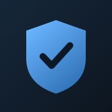
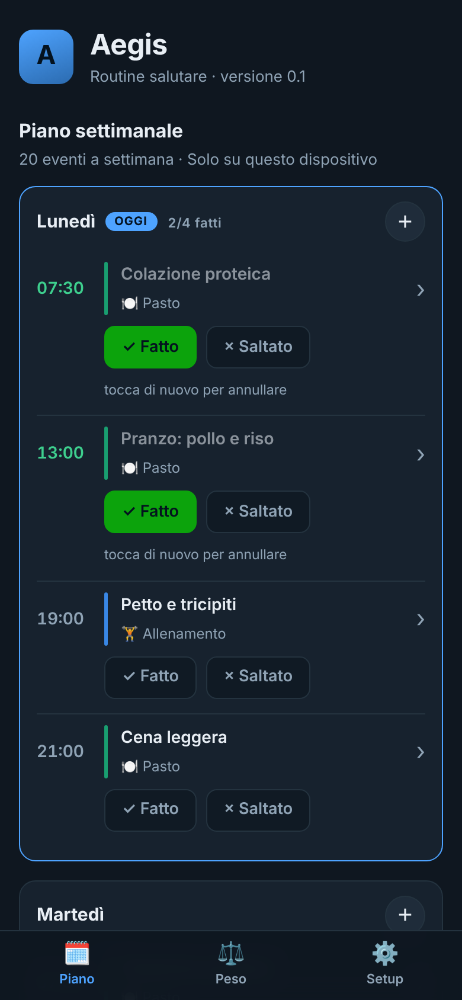
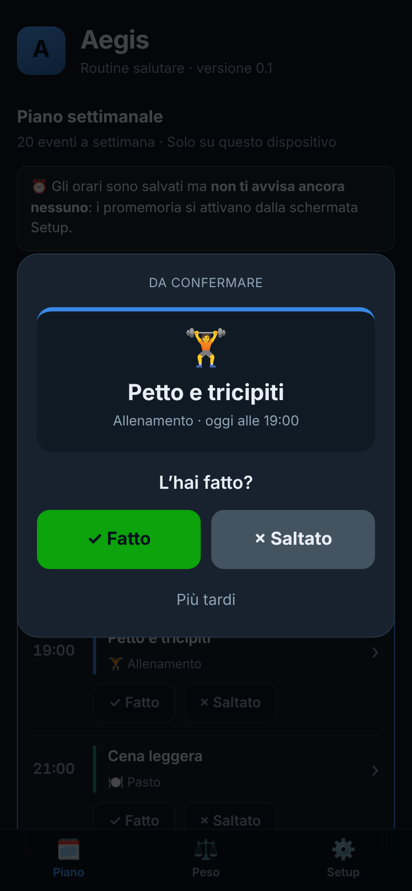
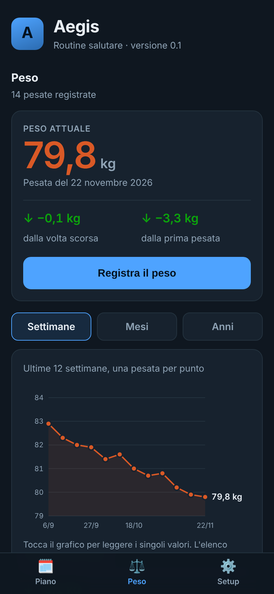
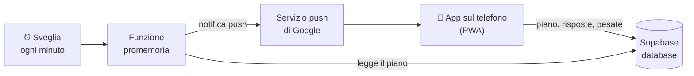

<div align="center">



# Aegis

**La tua routine settimanale, ricordata all'orario giusto.**

Allenamenti, pasti e controllo del peso in un piano che si ripete ogni settimana.<br>
Aegis ti avvisa sul telefono, ti chiede se l'hai fatto e costruisce lo storico.

[**Apri l'app →**](https://francyfibra-ai.github.io/Aegis-v.-0.1/)

`versione 0.1` · `PWA per Android` · `costo di esercizio: 0 €`

</div>

---

## Le schermate

<table>
  <tr>
    <td align="center" width="33%"></td>
    <td align="center" width="33%"></td>
    <td align="center" width="33%"></td>
  </tr>
  <tr>
    <td align="center"><b>Il piano</b><br><sub>La settimana giorno per giorno. Oggi è in evidenza, con il conto di quanto hai fatto.</sub></td>
    <td align="center"><b>«L'hai fatto?»</b><br><sub>Compare quando tocchi una notifica e quando apri l'app con eventi ancora da confermare.</sub></td>
    <td align="center"><b>Il peso</b><br><sub>Il valore attuale, le variazioni e l'andamento per settimane, mesi o anni.</sub></td>
  </tr>
</table>

---

## Cosa fa

- **🗓️ Un piano che si ripete.** Gli eventi si scrivono una volta sola, con giorno e orario, e valgono ogni settimana. Ci sono tre tipi: 🏋️ allenamento, 🍽️ pasto e ⚖️ peso.
- **🔔 Promemoria puntuali.** All'orario previsto arriva una notifica, anche ad app chiusa e con il telefono bloccato.
- **✓ Fatto o saltato.** Toccando la notifica, Aegis si apre e ti chiede com'è andata. Se la notifica l'hai ignorata, la domanda compare la prossima volta che apri l'app, un evento alla volta.
- **⚖️ Il peso nel tempo.** Le pesate disegnano un grafico. Se indichi un obiettivo (perdere, mantenere o aumentare), le variazioni si colorano di conseguenza.
- **☁️ I dati al sicuro.** Con l'accesso, il piano e lo storico sono salvati online e ti seguono su ogni dispositivo. Senza accesso restano sul telefono.

---

## Come funziona



1. **L'app** è una PWA: una pagina web che si installa sul telefono come un'app vera, con icona, schermo intero e notifiche. Non passa dal Play Store.
2. **Il database** (Supabase) conserva piano, risposte e pesate. Ogni riga è visibile solo a chi l'ha creata.
3. **La sveglia** gira ogni minuto dentro il database (`pg_cron`) e chiama la funzione `promemoria`. La funzione guarda quali eventi sono appena scattati e manda la notifica a tutti i dispositivi iscritti. Le notifiche partono con urgenza alta, così Android non le trattiene quando il telefono è a riposo.
4. **Se la sveglia si ferma**, l'app se ne accorge: oltre 5 minuti senza un giro andato a buon fine, in cima al Piano compare un avviso rosso con il motivo (segreto sbagliato, funzione mancante o in errore, programmazione spenta).
5. **Se un invio non riesce**, la sveglia riprova al giro dopo, fino a 10 minuti dall'orario. Oltre si rinuncia: un promemoria del pranzo a metà pomeriggio sarebbe solo fastidio.

Spiegazione completa in [docs/architettura.md](docs/architettura.md).

---

## Due scelte di progetto

**La notifica non ha pulsanti.** All'inizio li aveva. Poi una verifica sul dispositivo ha mostrato che Android, in certi casi, riportava il pulsante sbagliato: premendo *Fatto* arrivava *saltato*. Su uno storico che serve a capire come stai andando, un dato falso è peggio di un dato mancante, perché il vuoto si nota e la risposta sbagliata no. Per questo la notifica ricorda e basta, e la risposta si dà nell'app.

**Il peso è diverso dagli altri eventi.** Non si risponde sì o no, si scrive un numero. Per questo la sua notifica apre direttamente il campo dei chili.

Le altre scelte, con le alternative scartate, sono in [docs/scelte-tecniche.md](docs/scelte-tecniche.md).

---

## Tecnologie

| | |
|---|---|
| **Interfaccia** | React 18 + Vite, in JavaScript semplice. CSS scritto a mano, senza librerie grafiche |
| **Grafico** | SVG disegnato a mano: nessuna libreria esterna ([docs/grafico-peso.md](docs/grafico-peso.md)) |
| **Dati e accesso** | Supabase: PostgreSQL con regole di protezione per riga |
| **Notifiche** | Web Push con chiavi VAPID. Firma e cifratura scritte a mano su Web Crypto, senza pacchetti di terzi |
| **Sveglia** | `pg_cron` + `pg_net` nel database, Edge Function in Deno/TypeScript |
| **Pubblicazione** | GitHub Actions → GitHub Pages per l'app, Supabase CLI per la funzione |

---

## Struttura del progetto

```
├── src/
│   ├── App.jsx                     struttura generale e navigazione
│   ├── components/
│   │   ├── PaginaPiano.jsx         il piano settimanale
│   │   ├── PaginaPeso.jsx          peso attuale, variazioni e grafico
│   │   ├── PaginaSetup.jsx         accesso, promemoria, diagnostica, copie di sicurezza
│   │   ├── MascheraConferma.jsx    la domanda «l'hai fatto?»
│   │   ├── EditorEvento.jsx        aggiungere o modificare un evento
│   │   ├── EditorPesata.jsx        registrare una pesata
│   │   └── GraficoPeso.jsx         il grafico, in SVG
│   └── lib/
│       ├── modello.js              la forma dei dati: eventi, pesate, risposte
│       ├── archivio.js             l'unico punto che legge e salva i dati
│       ├── archivioLocale.js       …nella memoria del telefono
│       ├── archivioRemoto.js       …nel database online
│       ├── push.js                 iscrizione del dispositivo alle notifiche
│       ├── sveglia.js              «la sveglia sta girando?»
│       └── statistichePeso.js      i conti dietro al grafico
│
├── public/
│   ├── sw.js                       service worker: riceve e mostra le notifiche
│   └── manifest.webmanifest        rende l'app installabile
│
├── supabase/
│   ├── schema.sql                  tabelle e regole di protezione
│   ├── schema-notifiche.sql        iscrizioni e storico degli invii
│   ├── cron.sql                    la sveglia
│   ├── stato-sveglia.sql           permette all'app di sapere se la sveglia gira
│   └── functions/promemoria/       la funzione che manda i promemoria
│
├── .github/workflows/              pubblicazione automatica e cambio chiavi
└── docs/                           guide in italiano
```

**Il file da conoscere è `src/lib/archivio.js`.** È l'unico punto che tocca i dati: le schermate chiedono «dammi gli eventi» o «salva questa risposta» senza sapere dove finiscano. Con l'accesso, archivio.js li manda al database. Senza, li tiene sul telefono. Al primo accesso propone di portare online quello che c'era.

---

## Provarla in locale

Serve [Node.js](https://nodejs.org) 18 o superiore.

```bash
npm install
```

```bash
npm run dev
```

L'app si apre su `http://localhost:5173`. Per aprirla dal telefono sulla stessa rete WiFi, usa l'indirizzo `http://192.168.…:5173` che compare nel terminale.

> Da quell'indirizzo le notifiche non funzionano: Android le consente solo in `https://`. Per provarle va usata la versione online.

| Comando | Cosa fa |
|---|---|
| `npm run dev` | avvia l'app in locale |
| `npm run build` | prepara la versione da pubblicare in `dist/` |
| `npm run preview` | mostra il risultato di `build` |

L'app online si aggiorna da sola a ogni modifica su GitHub. Vive nella sottocartella `/Aegis-v.-0.1/`: se un giorno passa a un dominio suo, basta cambiare `CARTELLA_ONLINE` in `vite.config.js`.

---

## Le guide

| Guida | Di cosa parla |
|---|---|
| [Pubblicare l'app](docs/02-pubblicare-app.md) | la prima messa online su GitHub Pages |
| [Account Supabase](docs/03-account-supabase.md) | database, accesso e regole di protezione |
| [Notifiche](docs/04-notifiche.md) | chiavi, funzione, sveglia, prove e cambio delle chiavi |
| [Altre persone](docs/05-altre-persone.md) | far usare Aegis a qualcun altro |
| [Architettura](docs/architettura.md) | come stanno insieme i pezzi |
| [Scelte tecniche](docs/scelte-tecniche.md) | perché così e non altrimenti |
| [Grafico del peso](docs/grafico-peso.md) | come è costruito e come si legge |
| [Domande frequenti](docs/domande-frequenti.md) | i problemi già incontrati e come si risolvono |

---

## A che punto è

| | Fase | |
|---|---|---|
| 1 | Progetto e app installabile | ✅ |
| 2 | Piano settimanale, peso e grafico | ✅ |
| 3 | Archivio online e accesso | ✅ |
| 4 | Notifiche push | ✅ |
| 5 | Conferma Fatto / Saltato | ✅ |

**Dopo la v0.1, le idee in fila:**
- una copia dei dati sul telefono per quando manca la rete, che si sincronizza al ritorno della connessione.

Aegis v0.1 è il primo tassello di un sistema più ampio. Questa versione fa una cosa sola, e la fa per bene.
